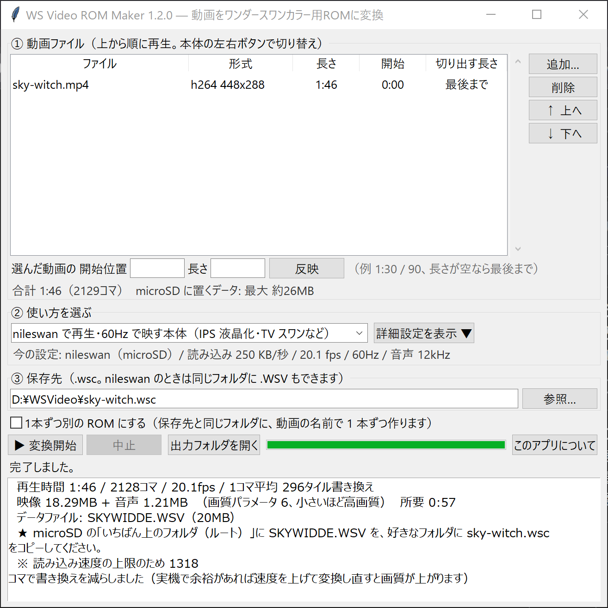
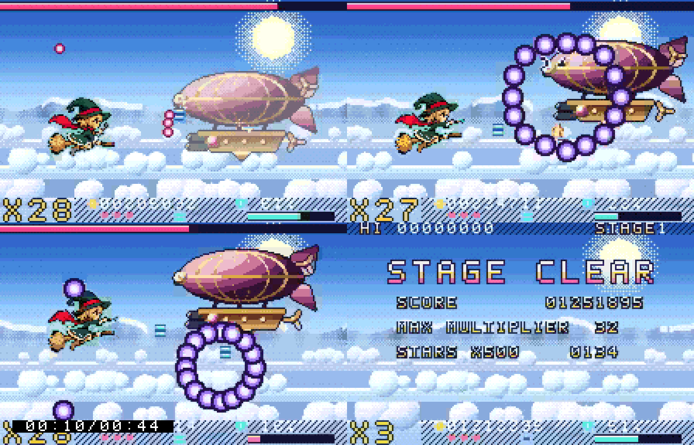

# WS Video ROM Maker

いろいろな形式の動画を、**ワンダースワンカラー / スワンクリスタルの実機で再生できる形** に変換する Windows 用アプリです。
フラッシュカートリッジ **nileswan** を使えば、microSD から読みながら再生するので、アニメ1話分のような長い動画も再生できます。

作者: BW　／　ライセンス: MIT（同梱ソフトはそれぞれのライセンス。下の「ライセンス」を参照）




---

## できること

- mp4 / mkv / avi / mov / wmv / webm / flv / mpg / ts / gif など、ほとんどの動画を変換できます
- 1コマ最大 241色（4096色中）、224×144 ドット、音声つき（8bit / 12kHz）
- **nileswan なら ROM 容量の制限なし**（microSD から読みながら再生）。ほかのフラッシュカートなら ROM の中に最大 16MB
- 本体で 一時停止・10秒 / 1分ジャンプ・次の動画 / 前の動画・音量の切り替え
- 60Hz モード（IPS 液晶化した本体や TV スワンなど、60Hz で映す本体向け）
- 複数の動画を1つにまとめられます。ウィンドウに動画をドラッグ＆ドロップするだけ

## 必要なもの

- Windows 10 / 11（64bit）のパソコン
- ワンダースワンカラー または スワンクリスタル（白黒のワンダースワンでは動きません）
- フラッシュカートリッジ
  - **nileswan**（おすすめ・長い動画も OK）… FAT32 でフォーマットした microSD
  - それ以外のフラッシュカート … ROM の中に入れる形式（最大16MB = 動画数分程度）

## ダウンロードと起動

1. 配布ページから `WSVideoRomMaker-x.x.x.zip` をダウンロードします。
2. zip を右クリック →「すべて展開」で、好きな場所に展開します（zip の中から直接起動しないでください）。
3. 展開したフォルダの中の `WSVideoRomMaker.exe` をダブルクリックします。

> **「Windows によって PC が保護されました」と出たとき**
> 個人が作ったアプリには、この表示がよく出ます（有料の電子署名をしていないため）。
> 「**詳細情報**」をクリック →「**実行**」を押すと起動できます。
>
> ウイルス対策ソフトが誤って警告することもまれにあります。その場合は、配布ページからダウンロードしたものであることを確認したうえで、
> 除外設定をしてください。心配な場合はソースコードから自分でビルドすることもできます（下の「自分でビルドする」）。

## 使い方

1. 動画をウィンドウに**ドラッグ＆ドロップ**（または「追加…」）します。複数入れると、**1つの ROM にまとめて**、上から順に再生されます（本体の X2 / X4 で動画を切り替え）。
   - 動画ごとに別の ROM にしたいときは、「③ 保存先」の下の「**1本ずつ別の ROM にする**」に印を付けます。保存先と同じフォルダに、動画の名前の ROM が1本ずつできます。
   - 一覧で動画を選んで「開始位置」「長さ」を入れると、一部だけ切り出せます（例: `1:30`、`90`）。
2. 「**② 使い方を選ぶ**」で、自分の環境に合うものを選びます。これだけで設定がまとめて決まります。

   | 選ぶもの | 向いている環境 | 設定 |
   |---|---|---|
   | nileswan で再生・60Hz で映す本体 | IPS 液晶化した本体、TV スワンなど | 20.1fps / 60Hz |
   | nileswan で再生・純正の液晶 | 改造していない本体 | 18.9fps |
   | ROM に入れる | nileswan 以外のフラッシュカート | 15.1fps / 最大16MB |

3. 「③ 保存先」を確認して「**▶ 変換開始**」を押します。
4. できたファイルを本体に入れて、再生します。
   - **nileswan**: `〇〇.wsc` と `XXXXXXXX.WSV` の2つができます。
     **`.WSV` は microSD の「いちばん上の階層（ルート）」に**、`.wsc` は好きなフォルダにコピーし、メニューから `.wsc` を起動します。
     `.WSV` の名前は変えないでください（`.wsc` の名前は変えても大丈夫です）。
     `.WSV` の名前は、変換したときの `.wsc` の名前から自動で決まります。**同じ名前の `.wsc` で別の動画を変換すると、`.WSV` も同じ名前になり、microSD の中で上書きになります。** 保存先の名前は、いちばん上の動画の名前から自動で付くので、ふつうはそのままで大丈夫です。
   - **ROM に入れる**: できた `.wsc` をフラッシュカートに書き込みます。

設定と保存先のフォルダは、次に起動したときも覚えています。細かく決めたいときは「詳細設定を表示」を押してください。

### 変換にかかる時間の目安

パソコンの CPU のコアを全部使って並列に変換します。12コアの PC で、24分のアニメ1話が 6〜8分ほどです。
「確認用のプレビュー動画も作る」をオフにすると少し速くなります。

## 本体の操作

| ボタン | 動作 |
|---|---|
| START / A | 一時停止・再開（一時停止中は再生位置を表示） |
| Y2（右）/ Y4（左） | 10秒先へ / 10秒前へ |
| Y1（上）/ Y3（下） | 1分先へ / 1分前へ |
| B | 今の動画を最初から |
| X2（右）/ X4（左） | 次の動画 / 前の動画 |
| X1（上）/ X3（下） | 本体スピーカーの音量（50% / 25% / 12.5%。イヤホンの音量は変わりません） |

最後の動画が終わると、最初に戻って繰り返します。

## 詳細設定の説明

| 設定 | 説明 |
|---|---|
| 出力の形式 | nileswan の microSD から再生 / ROM に入れる |
| フレームレート | 上げると動きが滑らかになりますが、1コマあたりのデータが減るので、動きの多い場面でブロック状のノイズが増えます |
| microSD の読み込み速度 | 1秒に読むデータの上限。250KB/秒が標準（実機で確認済み）。上げると画質が上がりますが、読み込みが追いつかないと映像が止まりがちになります |
| 1コマの色数 | 241色（標準）/ 121色（変換が3割ほど速い） |
| 音声 | 12kHz（標準）/ 6kHz / 4kHz / なし |
| 画質 | ROM 形式では「自動」で ROM に入りきる範囲で一番きれいにします |
| 画面の合わせ方 | 全体を表示（黒帯）/ 画面いっぱい（端を切る）/ 引き伸ばし |
| ディザ | 色の少なさを細かい模様で補います。アニメやゲーム画面では「弱」も試してみてください |
| 60Hz モード | 60Hz で映す本体（IPS 液晶化・TV スワン）向け。**純正の液晶では正しく映らないことがあります** |

## うまくいかないとき

**nileswan の一覧で、名前が「?」になる／選ぶと「Error 6」と出る**

`.wsc` の名前が長すぎます。短い名前に変えてください（`.wsc` の名前は、変えても大丈夫です）。
保存先の名前は、動画の名前から自動で付きますが、長い場合は 40 文字までで切ります。

**nileswan でエラー画面が出た**

| 表示 | 意味と対処 |
|---|---|
| FILE NOT FOUND | `.WSV` が microSD のルートにありません。名前を変えていないかも確認してください |
| FILE TOO FRAGMENTED | ファイルが細切れに保存されています。一度消してからコピーし直してください |
| SD CARD ERROR / SD READ ERROR | microSD の読み込みに失敗しました。差し直す・別のカードで試す |
| NO FAT32 PARTITION | microSD を FAT32 でフォーマットしてください |
| BAD DATA FILE | `.wsc` と `.WSV` の組み合わせが違うか、ファイルが壊れています。両方コピーし直してください |

問い合わせのときは、画面に出ている CODE の数字（と、その下の数字）を一緒に教えてください。

**画面の上が黒くなる・ずれる** … 60Hz モードがその本体に合っていません。60Hz モードを外して変換し直してください。

**nileswan で、長く見ていると音が飛ぶ・映像が止まる** … microSD の読み込みが追いついていません。一時停止すると、時間の下に「映像 / 音声」の先読みの量（64KB 単位）が出ます。
数字が 0 に近いときは、詳細設定の「microSD の読み込み速度」を一段下げて変換し直してください。

**本体スピーカーで音が割れる** … 詳細設定の「本体スピーカーの音量」を「小」にしてください。

**ROM に入りきらない** … 「nileswan で再生」にするか、動画を短くする・フレームレートや音声の品質を下げてください。

## 動作確認の範囲

- 作者の実機（nileswan + IPS 液晶化したワンダースワンカラー）で、nileswan 版の起動・再生・映像と音の同期・ボタン操作を確認しています。
  60Hz モードは IPS 液晶化した本体と TV スワンで正しく映ることを確認しています。**純正の液晶での 60Hz モードは確認していません。**
- 1.1.0 も実機で再生できることを確認しています。動きの激しい場面では、まだブロック状のノイズが出ることがあります。
  microSD の読み込み方式の変更でどれだけ速くなったかは、実機では測っていません。
- スワンクリスタル、改造していない本体、nileswan 以外のフラッシュカート、作者が使ったもの以外の microSD カードでの動作は確認していません。
  ROM に入れる形式は、nileswan に ROM として書き込んで実機で再生できることを確認しています（最初の版で）。

## 注意

- **非公式のツールです。** 株式会社バンダイ、nileswan の開発者とは関係ありません。
  「ワンダースワン」「ワンダースワンカラー」「スワンクリスタル」は株式会社バンダイの商標です。
- 変換したファイルは、**ご自身で楽しむため**に使ってください。他人の作品（アニメ・映画など）を変換したファイルを配布しないでください。
- 60Hz モードは本体の表示の設定を変える実験的な機能です。本体への影響も含めて**自己責任**でお使いください。
- このアプリは無保証です（MIT ライセンス）。

## ライセンス

- アプリ本体: MIT ライセンス（`LICENSE`）、Copyright (c) 2026 BW
- 同梱している FFmpeg は **GNU GPL v3** です。そのほか Python、NumPy、Pillow、Tcl/Tk、tkinterdnd2、PyInstaller を含みます。
  詳しくは `THIRD_PARTY_NOTICES.md` と `licenses` フォルダを見てください。FFmpeg のソース（`ffmpeg-9.0.2.tar.xz`）は GitHub の Releases に添付しています。
- nileswan の microSD の読み方は libnile（zlib ライセンス）を参考にしました。

## 自分でビルドする（開発者向け）

```
pip install numpy pillow imageio-ffmpeg tkinterdnd2 pyinstaller
python build_player.py        # 再生プレイヤー（NASM が必要: tools/nasm/nasm.exe に置く）
python build_exe.py           # exe と zip を作る
cd src && python -m wsvideo.cli 入力.mp4 -o 出力.wsc --target nile   # コマンドライン版
```

再生プレイヤーは NASM（https://www.nasm.us/ ）でアセンブルします。仕組みの説明は `docs/` を見てください。

## 更新履歴

- 1.2.0（2026年11月）… 自動で付ける保存先の名前を、40 文字までで切るようにしました（長すぎる名前は、nileswan の一覧で選べないため）。「1本ずつ別の ROM にする」を追加。一覧に入れた動画を、1つにまとめずに、動画ごとの ROM（nileswan のときは `.WSV` も）として続けて変換できます。
- 1.1.1（2026年11月）… 保存先の名前を、動画を入れ替えるたびに、いちばん上の動画の名前から付け直すようにしました（自分で決めた名前は変えません）。別の動画を続けて変換したときに、`.WSV` が同じ名前になってしまうのを防ぎます。
- 1.1.0（2026年11月）… 画質の改善。動きの激しい場面で、色を2色・4色に減らした小さいタイルで画面全体を少しずつ更新するようにし、ブロックノイズを減らしました（同じデータ量で元の映像との差が約2割減）。nileswan の microSD の読み込みを、受信と書き写しを並行して行う方式にして速くしました。
- 1.0.0（2026年11月）… 最初の版（公開は 1.1.0 から）
